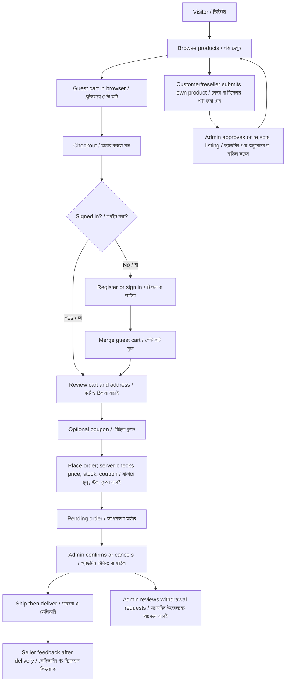

# AyerGhor Marketplace Workflow

This guide describes the backend and connected React storefront as implemented.
It is written in English and Bangla. The default interface language is English;
users can switch between English and Bangla in the frontend.

## Database migration status / ডাটাবেস মাইগ্রেশন অবস্থা

**Verified on 22 October 2026:** `php artisan migrate:status` reported every
migration currently in `database/migrations` as **Ran**. This includes the
reseller, coupon, delivery-charge, and checkout migration
`2026_10_22_000005_add_reseller_checkout_and_coupon_support`.

There were 17 migration files and no pending migrations at verification time.
The migrations create or extend these application and Laravel support tables:

| Table | Purpose |
| --- | --- |
| `users` | Customer, reseller, and super-admin accounts |
| `customer_profiles` | Customer address and location |
| `districts`, `thanas` | Address lookup data |
| `categories` | Product categories |
| `products` | Admin and seller-submitted catalog items |
| `cart_items` | Persistent, signed-in user cart |
| `orders`, `order_items` | Checkout, totals, order status, and seller per line |
| `coupons`, `coupon_redemptions` | Coupon rules and applied coupon records |
| `store_settings` | Store-wide settings, including delivery charge |
| `wallet_transactions` | Money and points ledger |
| `marketing_accounts`, `commissions` | Referral accounts and commission records |
| `withdrawal_requests` | Cash withdrawal and product adjustment requests |
| `sales_feedback` | Feedback for delivered sales |
| `notifications` | Laravel database notifications |
| `personal_access_tokens` | Sanctum API authentication tokens |
| `cache`, `cache_locks` | Laravel cache tables |
| `jobs`, `job_batches`, `failed_jobs` | Laravel queue tables |
| `migrations` | Laravel's record of applied migrations |

The migration check confirms that all current migration files ran against the
database configured for this backend. It is not a check of another environment
or a guarantee that sample location data is exhaustive. To check later:

```powershell
php artisan migrate:status
```

Never use `migrate:fresh` on a database containing data you need to keep.

## Roles / ব্যবহারকারীর ধরন

| Role | English | বাংলা |
| --- | --- | --- |
| `super_admin` | Manages the catalog, seller approvals, orders, coupons, delivery charge, and withdrawals. | পণ্য, বিক্রেতার অনুমোদন, অর্ডার, কুপন, ডেলিভারি চার্জ ও উত্তোলন পরিচালনা করেন। |
| `customer` | Can browse, keep a cart, buy, submit products for review, and use account features. | পণ্য দেখতে, কার্ট রাখতে, কিনতে, পণ্য জমা দিতে এবং অ্যাকাউন্টের সুবিধা ব্যবহার করতে পারেন। |
| `reseller` | Has the same buyer and seller capabilities as a customer, with a distinct account role. | আলাদা অ্যাকাউন্ট ধরনসহ ক্রেতা ও বিক্রেতা—দুইভাবেই কাজ করতে পারেন। |

Super-admin accounts are provisioned by the administrator/seeder; public
registration only accepts `customer` or `reseller`. For a fresh database, set
`SUPER_ADMIN_MOBILE` and `SUPER_ADMIN_PASSWORD` in the local `.env` before
running the seeder. These values are intentionally not committed.

## End-to-end flow / শুরু থেকে শেষ পর্যন্ত



## 1. Registration and sign-in / নিবন্ধন ও লগইন

1. A visitor chooses **Customer** or **Reseller**, and submits their name,
   Bangladesh mobile number, address, district/thana, and password. Email and
   Facebook profile are optional.
2. The backend validates required fields, mobile uniqueness and format, and
   that the selected thana belongs to the selected district. A super-admin
   role cannot be requested through public registration.
3. On success, the backend creates the account/profile and issues a Sanctum
   token. The selected English/Bangla preference is saved.
4. On later sign-ins, the mobile number and password are checked and a token is
   issued. Admin routes are restricted to `super_admin`; customer routes allow
   both `customer` and `reseller`.
5. If a visitor was checking out, successful login or registration returns them
   to the cart.

**বাংলা:** নিবন্ধনের সময় ক্রেতা অথবা রিসেলার বেছে নিয়ে নাম, বাংলাদেশি
মোবাইল নম্বর, ঠিকানা, জেলা/থানা ও পাসওয়ার্ড দিতে হয়। ইমেইল ও Facebook
প্রোফাইল ঐচ্ছিক। সার্ভার মোবাইল নম্বর, ঠিকানা এবং জেলা-থানার সম্পর্ক যাচাই
করে। পাবলিক রেজিস্ট্রেশনে সুপার অ্যাডমিন তৈরি করা যায় না। সফল হলে অ্যাকাউন্ট
তৈরি হয়, API token দেওয়া হয় এবং ভাষার পছন্দ সংরক্ষিত হয়। কার্ট থেকে লগইন
বা নিবন্ধন করলে ব্যবহারকারী আবার কার্টে ফিরে আসেন।

## 2. Product browsing and cart / পণ্য দেখা ও কার্ট

- Product and category browsing is public. Guests can add products to a
  browser-local cart without signing in.
- For signed-in customers/resellers, cart items are stored in `cart_items`.
- After sign-in, guest cart lines are sent to the merge endpoint; the server
  validates active products and stock and merges them into the user's cart.
- Quantity changes and removals update the corresponding cart.
- Checkout is the point where an unauthenticated visitor must sign in. Admin
  accounts are not customer checkout accounts.
- The backend rechecks each product, seller ownership, and stock at checkout;
  client-side prices are not trusted.

**বাংলা:** পণ্য ও ক্যাটাগরি লগইন ছাড়াই দেখা যায়। অতিথি ব্রাউজারের local
storage-এ কার্ট রাখতে পারেন। লগইন করলে পণ্য ও পরিমাণ সার্ভারে যাচাই করে
অ্যাকাউন্টের কার্টের সঙ্গে যুক্ত হয়। কেনার সময় লগইন দরকার; অ্যাডমিন অ্যাকাউন্ট
দিয়ে গ্রাহক হিসেবে checkout করা যায় না। অর্ডার দেওয়ার সময় সার্ভার আবার
পণ্যের সক্রিয় অবস্থা, স্টক, বিক্রেতা এবং বর্তমান মূল্য যাচাই করে।

## 3. Admin catalog management / অ্যাডমিনের পণ্য পরিচালনা

The super-admin can create, edit, and delete catalog products; set category,
description, price, optional sale price, stock, active/featured status; and
upload or remove a product image. Uploaded images are validated (JPG/JPEG,
PNG, WEBP; maximum 5 MB) and stored on Laravel's public disk. A sale price must
not be greater than the regular price.

Inactive products are not purchasable. Product deletion uses the application's
soft-delete behavior.

**বাংলা:** সুপার অ্যাডমিন পণ্য তৈরি, সম্পাদনা ও মুছতে পারেন; ক্যাটাগরি,
বিবরণ, নিয়মিত মূল্য, ঐচ্ছিক ছাড়ের মূল্য, স্টক, সক্রিয়/বিশেষ পণ্যের অবস্থা
নির্ধারণ এবং ছবি আপলোড/সরাতে পারেন। JPG/JPEG, PNG ও WEBP ছবি সর্বোচ্চ ৫ MB
পর্যন্ত গ্রহণ করা হয়। ছাড়ের মূল্য নিয়মিত মূল্যের বেশি হতে পারে না।
নিষ্ক্রিয় পণ্য কেনা যায় না।

## 4. Customer/reseller product submissions / ক্রেতা-রিসেলারের পণ্য জমা

1. A signed-in customer or reseller submits a product name, active category,
   price, stock, optional sale price, description, and optional image.
2. The backend creates it as `pending` and inactive, so it is not visible for
   sale before review.
3. The super-admin reviews the seller submission and approves or rejects it.
   Approval activates and publishes the product; rejection leaves it
   unavailable.
4. The seller cannot buy their own listing.

**বাংলা:** লগইন করা ক্রেতা বা রিসেলার পণ্যের নাম, সক্রিয় ক্যাটাগরি, মূল্য,
স্টক, ঐচ্ছিক ছাড়ের মূল্য, বিবরণ ও ঐচ্ছিক ছবি জমা দেন। পণ্যটি প্রথমে
`pending` এবং নিষ্ক্রিয় থাকে; অ্যাডমিন অনুমোদন করলে সক্রিয় হয়ে বিক্রির জন্য
প্রকাশিত হয়, বাতিল করলে বিক্রি হয় না। বিক্রেতা নিজের পণ্য নিজে কিনতে পারেন
না।

## 5. Coupons, discounts, and delivery / কুপন, ছাড় ও ডেলিভারি

### Admin / অ্যাডমিন

- Creates or edits a unique coupon code.
- Chooses fixed-amount or percentage discount and configures minimum order,
  optional maximum discount, overall/per-user usage limits, start/expiry time,
  and active status.
- Sets the store's delivery charge in admin settings.
- Redeemed coupons cannot be deleted; deactivate them instead.

### Buyer / ক্রেতা

- Can preview a coupon from the cart. The preview validates current product
  availability and calculates the subtotal from server-side product prices.
- The order submission sends the coupon code again. The server revalidates the
  coupon and calculates the authoritative amount in the order transaction.
- A coupon preview is cleared logically if cart contents change; apply it again
  to see the updated discount.
- The current calculation is:

  ```text
  subtotal = sum(current unit price × quantity)
  total = max(0, subtotal - coupon discount) + delivery charge
  ```

  Percentage coupons may be capped by `maximum_discount`; discount cannot
  exceed subtotal. Coupon discount applies to subtotal, not the delivery fee.
- Order records retain subtotal, discount, delivery charge, coupon, and total.
  A successful redemption is recorded in `coupon_redemptions`.

**বাংলা:** অ্যাডমিন নির্দিষ্ট অঙ্ক বা শতাংশের কুপন, সর্বনিম্ন অর্ডার মূল্য,
ঐচ্ছিক সর্বোচ্চ ছাড়, মোট/ব্যবহারকারী-প্রতি ব্যবহারের সীমা, শুরুর ও শেষের
সময় এবং সক্রিয় অবস্থা নির্ধারণ করেন। অ্যাডমিন ডেলিভারি চার্জও সেট করেন।
ক্রেতা কার্টে কুপন পরীক্ষা করতে পারেন; অর্ডার দেওয়ার সময় সার্ভার আবার
পণ্যের বর্তমান মূল্য, স্টক ও কুপনের নিয়ম যাচাই করে। হিসাব:
`মোট = সর্বোচ্চ(০, সাবটোটাল − কুপনের ছাড়) + ডেলিভারি চার্জ`। কুপনের ছাড়
ডেলিভারি চার্জে প্রযোজ্য নয়। অর্ডার ও রিডেম্পশন রেকর্ডে এই হিসাব সংরক্ষিত হয়।

## 6. Order and seller feedback / অর্ডার ও বিক্রেতার ফিডব্যাক

1. A customer/reseller submits shipping address and cart lines with optional
   coupon. Payment method currently supported by checkout is cash on delivery.
2. The server checks availability, rejects self-purchase, locks/checks stock,
   calculates totals, creates the order and its seller-attributed order items,
   reduces stock, records coupon redemption, and clears the purchased cart
   lines—all within a database transaction.
3. New orders start `pending`. Admin transitions are:
   `pending -> confirmed -> shipped -> delivered`, with cancellation allowed
   from `pending` or `confirmed`. Cancellation restores product stock.
4. Delivery marks payment status as paid in the current admin order workflow.
5. A seller associated with a delivered order item may submit feedback for that
   sale.

**বাংলা:** ক্রেতা/রিসেলার ঠিকানা ও কার্টের পণ্য দিয়ে অর্ডার করেন; বর্তমানে
checkout-এ Cash on Delivery আছে। সার্ভার স্টক ও মূল্য যাচাই করে, নিজের পণ্য
কেনা আটকায়, মোট হিসাব করে, অর্ডার/প্রতি-বিক্রেতার order item তৈরি করে,
স্টক কমায়, কুপন রিডেম্পশন সংরক্ষণ করে এবং কেনা পণ্য কার্ট থেকে সরায়—সব
একটি transaction-এ। অর্ডারের ধাপ `pending → confirmed → shipped → delivered`;
`pending` বা `confirmed` থেকে বাতিল করা যায়, এবং বাতিলে স্টক ফেরত যায়।
ডেলিভারির পর সংশ্লিষ্ট বিক্রেতা সেই বিক্রির জন্য ফিডব্যাক দিতে পারেন।

## 7. Marketing IDs and earnings / মার্কেটিং আইডি ও আয়

- A user may create multiple marketing IDs. A new ID may optionally reference
  an active parent/referrer marketing ID.
- Referral ancestry is limited to 10 levels.
- `marketing_accounts`, `commissions`, and `wallet_transactions` provide the
  data structures for marketing and earnings records.
- **Important current limitation:** order checkout does not yet automatically
  calculate seller profit shares, company shares, buyer/marketer rewards,
  purchase points, or multi-level commissions. Commission rates and
  accounting rules have not been specified, so these amounts must not be
  assumed to be paid automatically.

**বাংলা:** একজন ব্যবহারকারী একাধিক মার্কেটিং আইডি তৈরি করতে পারেন এবং চাইলে
সক্রিয় রেফারার আইডি যুক্ত করতে পারেন। রেফারেল সর্বোচ্চ ১০ স্তর পর্যন্ত।
মার্কেটিং, কমিশন ও ওয়ালেটের ডেটাবেস টেবিল রয়েছে। **তবে বর্তমানে অর্ডার
checkout স্বয়ংক্রিয়ভাবে বিক্রেতা/প্রতিষ্ঠানের লাভ ভাগ, ক্রেতা বা মার্কেটারের
পুরস্কার, কেনাকাটার পয়েন্ট কিংবা ১০-স্তরের কমিশন গণনা ও জমা করে না।** কমিশনের
হার এবং হিসাবের নিয়ম নির্ধারিত না থাকায় এগুলো স্বয়ংক্রিয় আয় বলে গণ্য করা
যাবে না।

## 8. Withdrawals / টাকা বা পণ্যের মাধ্যমে উত্তোলন

- A user requests cash (minimum BDT 500) or a product adjustment using points.
- The backend checks available ledger balance/points and reserves pending or
  approved withdrawal amounts when checking subsequent requests.
- Admin may approve/reject the request; product adjustments can include a
  delivery fee. Approved requests can be completed.
- This flow records and manages requests; it does not define a point-to-BDT
  exchange rate or automatically credit purchase points.

**বাংলা:** ব্যবহারকারী নগদ উত্তোলনের আবেদন করতে পারেন (সর্বনিম্ন ৫০০ টাকা),
অথবা পয়েন্ট ব্যবহার করে পণ্যের মাধ্যমে সমন্বয়ের আবেদন করতে পারেন। সার্ভার
ওয়ালেটের উপলব্ধ টাকা/পয়েন্ট যাচাই করে এবং চলমান আবেদনের পরিমাণ হিসাব করে।
অ্যাডমিন অনুমোদন/বাতিল করেন; পণ্য সমন্বয়ে ডেলিভারি চার্জ যোগ হতে পারে।
তবে পয়েন্ট-থেকে-টাকার বিনিময় হার নির্ধারিত নয় এবং কেনাকাটায় পয়েন্ট
স্বয়ংক্রিয়ভাবে জমা হয় না।

## 9. Notifications / নোটিফিকেশন

Seller product submissions notify active super-admins using Laravel's
database notification channel. SMS and Facebook Messenger delivery are **not
configured**; provider credentials and integrations are required before those
channels can send messages.

**বাংলা:** বিক্রেতা পণ্য জমা দিলে Laravel-এর database notification channel
দিয়ে সক্রিয় সুপার অ্যাডমিনদের নোটিফিকেশন পাঠানো হয়। SMS বা Facebook
Messenger এখনো সংযুক্ত/কনফিগার করা হয়নি; ওই মাধ্যমে পাঠাতে provider
credentials ও integration দরকার।

## Main API route groups / প্রধান API রুট

All routes below are under `/api`:

| Route | Access | Purpose |
| --- | --- | --- |
| `POST /register`, `POST /login` | Public | Register and sign in |
| `GET /products`, `GET /categories` | Public | Browse catalog |
| `GET /storefront/settings` | Public | Read delivery charge |
| `POST /coupons/validate` | Public | Preview a coupon against submitted cart lines |
| `/customer/cart/*` | Customer/reseller | Persistent cart and guest cart merge |
| `POST /customer/orders` | Customer/reseller | Checkout |
| `/customer/seller-products/*` | Customer/reseller | Submit and list own products |
| `/customer/dashboard`, `/customer/withdrawals/*` | Customer/reseller | Dashboard and withdrawal requests |
| `/customer/marketing-accounts/*` | Customer/reseller | Create/list marketing IDs |
| `/admin/products/*` | Super-admin | Catalog CRUD |
| `/admin/coupons/*`, `/admin/settings` | Super-admin | Coupon and delivery settings |
| `/admin/seller-products/*` | Super-admin | Review seller submissions |
| `/admin/orders/*`, `/admin/withdrawals/*` | Super-admin | Manage orders and withdrawal requests |

## Operational checks / পরিচালনাগত যাচাই

```powershell
# Check whether every migration in this codebase has run on the configured DB.
php artisan migrate:status

# Apply newly added migrations without resetting existing rows.
php artisan migrate

# Populate/update configured demo and reference data (not required for migrations).
php artisan db:seed
```

The seeded location records are sample/reference data; they should not be
assumed to contain every district and thana in Bangladesh. Do not run
`migrate:fresh` on a database whose data must be preserved.
